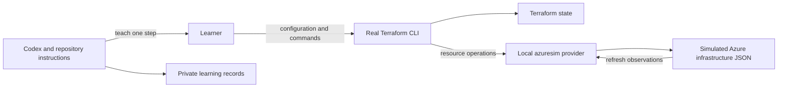

# Terraform Certification Mentor

A Codex-assisted study project for learning Terraform from zero toward HashiCorp Terraform Associate 004. Practical Azure lifecycle exercises use the **real Terraform CLI** with an independently maintained local Azure simulator.

Certification preparation is the primary goal. The repository also demonstrates repeatable teaching instructions, curriculum mapping, local provider integration, validation, and private session continuity for a public portfolio.

## Start or review

- **Learners:** follow [START_HERE.md](START_HERE.md). Begin with 00.1 — Desired state and Infrastructure as Code; commands are taught one at a time.
- **Reviewers:** read [PORTFOLIO.md](docs/PORTFOLIO.md) for architecture, decisions, evidence, and the limits of portfolio claims.
- **Contributors:** follow [CONTRIBUTING.md](CONTRIBUTING.md) for checks and safe synthetic reproductions.

**Required companion:** the separate terraform-azure-simulator implementation. The mentor alone cannot run Azure lifecycle exercises. See [acquisition and version requirements](docs/COMPANION_SIMULATOR.md); its public source and compatible release must be available before shared practical setup.

## How it works



Terraform performs configuration evaluation, dependency resolution, plans, state, refresh, and lifecycle processing. The provider performs local simulated Resource Group operations. Terraform state and simulated infrastructure are separate, enabling genuine drift exercises.

There is no Azure account, authentication, cloud provisioning, portal, or background server. The development agent prepares the provider; learning Go is not a prerequisite. The mentor is repository instructions and a skill used in Codex, rather than a standalone hosted application.

## Implemented and tested

| Area | Current scope |
| --- | --- |
| Certification | All 37 Associate 004 objectives mapped to an ordered curriculum and separate exam/practical records; Terraform 1.12 target |
| Teaching | One concept/command, prediction, actual execution, inspection, troubleshooting, teach-back, and assessment protocols |
| Azure simulator integration | azuresim 0.1.1 Resource Group create/read/tag-update/delete, replacement, external drift, corruption diagnostics, and guarded local installation |
| Supplemental examples | Five local configurations for language/module concepts and optional plan-only Terraform tests |
| Continuity | Per-learner private progress, review, gaps, history, and handoff templates; non-overwriting bootstrap |
| Verification | Python regression tests, package/public-file checks, and disposable real Terraform validation |

Full Resource Group runtime validation and all supplemental labs passed on macOS arm64 with Terraform 1.12.2. See [VALIDATION.md](docs/VALIDATION.md) for executed checks. Linux/WSL2 Terraform/provider runtime remains unverified. [Hosted package CI passed](https://github.com/Adrian-Mihai-Marghidan/terraform_certification_tutor/actions/runs/38006324091) on Ubuntu with Python 3.12; it checks the mentor package and Python regressions, without running Terraform or the simulator.

Curriculum coverage is a study/assessment map, not a claim that every future exercise is already implemented. Only Resource Groups are supported by the simulator; it is not a full AzureRM replacement. Data sources/import, remote backends, HCP functionality, and broader Azure behavior require explicit separate exercises or official explanations. See [LAB_COVERAGE.md](labs/LAB_COVERAGE.md) and [ROADMAP.md](docs/ROADMAP.md).

## Verify the public package

On macOS or Linux/WSL2, Python 3.9+ and Git are sufficient for these checks; no private records, Terraform, Go, simulator, or Azure account is needed:

```bash
python3 scripts/check_package.py
python3 -m unittest discover -s tests -v
python3 scripts/check_public_files.py
```

The last command checks tracked/staged content. Before the first commit, stage the public files; see [CONTRIBUTING.md](CONTRIBUTING.md). Runtime validation has additional local tool/simulator prerequisites.

## Privacy, provenance, and reuse

Each learner keeps their own progress and infrastructure locally. Private records, state/plans, stores, logs, credentials, and toolchains are excluded from public Git and require a separate private backup. Public test summaries use synthetic development fixtures and never establish learner competence.

This project was developed with Codex assistance. [PORTFOLIO.md](docs/PORTFOLIO.md) distinguishes project implementation from independently demonstrated skills or a certification result. It is an independent educational project and includes no official exam question bank.

Original project source and documentation are licensed under [MIT](LICENSE), as selected by the maintainer. See [publication preparation](docs/PORTFOLIO.md#publication-preparation) and [upstream references](THIRD_PARTY.md).
